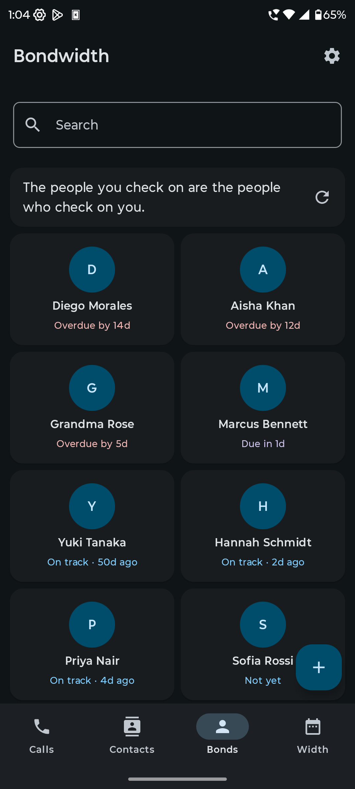
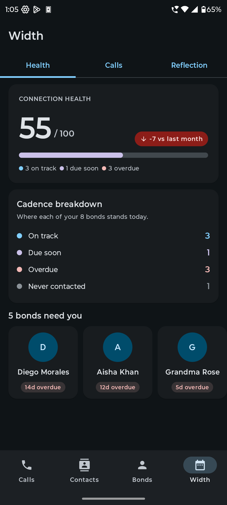
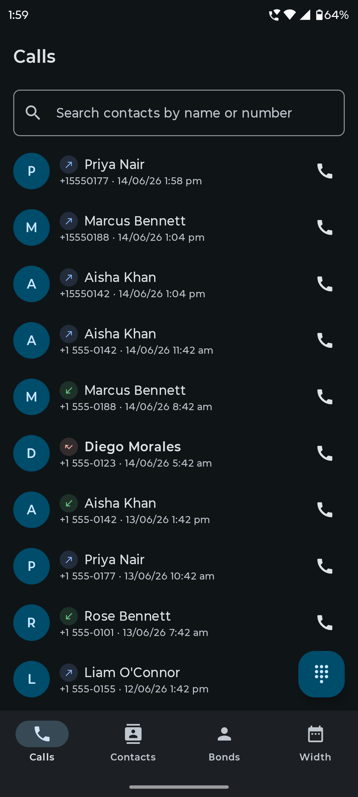
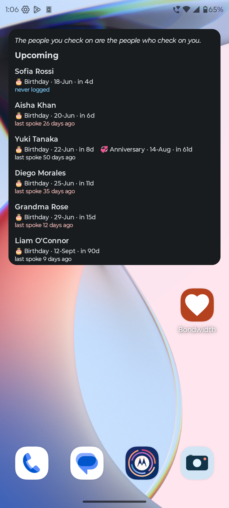

<p align="center">
  
</p>

<h1 align="center">Bondwidth</h1>

<p align="center">
  <b>Your phone, your contacts, your people — and nothing leaves your phone.</b><br>
  A free, open-source dialer and contacts app that quietly reminds you who you haven't called in a while.
</p>

<p align="center">
  <a href="https://f-droid.org/packages/com.phonepvr.friends/">
    
  </a>
</p>

<p align="center">
  <a href="https://f-droid.org/packages/com.phonepvr.friends/"></a>
  <a href="../../releases/latest"></a>
  
  
  
</p>

<p align="center">
  
  
  
  
</p>

---

## Why Bondwidth?

Weeks slip by. You mean to call your grandmother, your old roommate, your best friend — and then you don't. **Bondwidth fixes that, without becoming another app that watches you.**

- 📞 **It's your phone app.** Calls, contacts, recents, blocking, dual-SIM — everything you'd expect, in one clean Material You app.
- 🤝 **It remembers your people.** Pick who matters, choose how often you want to talk ("every 2 weeks"), and Bondwidth gently shows who's getting quiet. Calls count automatically.
- 🎂 **It never forgets a birthday.** Reminders a few days ahead, with a "mark as wished" button right on the notification.
- 🔒 **It can't spy on you — literally.** Bondwidth has **no internet permission at all**. No accounts, no cloud, no ads, no analytics. Your data cannot leave your phone unless you export it.

## Features

### 📞 A complete phone app
- Set up in **one tap**: make Bondwidth your phone app and Android grants everything it needs in a single step.
- Fast **T9 smart dial**, **speed dial** on keys 1–9, and **paste** a copied number straight into the dialpad.
- **Recents with filters** — All · Missed · Incoming · Outgoing — and contact search right in the Calls tab.
- Long-press any number for **call, message, WhatsApp, Signal, copy, share or block**.
- **Block numbers** (with a confirmation, so no accidental blocks) and, optionally, **block all private/hidden callers**.
- **Dual-SIM done right**: choose a SIM per call, or let Bondwidth **remember the SIM for each number**.
- Its own **in-call screen** that turns off at your ear, works over the lock screen, and supports picture-in-picture.
- **USSD codes** like `*123#` work as they should.

### 👥 Contacts that just work
- Browse, search and filter your address book by group — search also matches company, nickname, notes and email.
- Create and edit contacts with numbers, emails, address, website, notes, birthday, anniversary and photo.
- **Find and merge duplicates.**
- **Share a contact** as a card the other person saves in one tap (WhatsApp, Telegram, email) or as plain text for SMS.
- Import and export **vCards**.

### 🤝 Bonds — the part other dialers don't have
- A **check-in cadence** per person; overdue people float to the top, colour-coded.
- An automatic **timeline** of calls (calls under 3 seconds don't count), plus meet-ups, messages and notes you add.
- **Width**, your relationship dashboard: connection health, talk time, and a year in review.
- A **home-screen widget** for upcoming birthdays and who you haven't spoken to lately.
- Long-press to select and **remove several bonds at once**.

## Private by design

Privacy isn't a setting in Bondwidth — it's the architecture.

- **No `INTERNET` permission.** Not hidden, not optional: it isn't there, and the build fails if anything ever tries to add it.
- **No accounts, servers or trackers.** Nothing to sign into, nowhere for your data to go.
- **Backups stay yours** — one local file, optionally encrypted with AES-256-GCM, or scheduled automatic backups to a folder you choose.
- **App lock** with fingerprint or screen lock, and a mode that hides the app from screenshots, recordings and the recents screen.

## Install

| | |
| --- | --- |
| **F-Droid** (recommended) | [f-droid.org/packages/com.phonepvr.friends](https://f-droid.org/packages/com.phonepvr.friends/) — automatic updates, built from source |
| **GitHub** | Download `Bondwidth-x.y.z.apk` from the [latest release](../../releases/latest) |

Both are signed with the same key, so you can switch between them without losing data. F-Droid verifies that its own build of the source is byte-for-byte identical to the APK published here.

> Installing the APK straight from GitHub on Android 13+? Android asks you to allow "restricted settings" once before an app from outside an app store can become your phone app. Bondwidth walks you through it.

## Permissions, and why

| Permission | Why |
| --- | --- |
| `READ_CONTACTS` / `WRITE_CONTACTS` | Browse, add to and edit your address book |
| `READ_CALL_LOG` / `WRITE_CALL_LOG` | Show recents, count calls toward your bonds, delete or re-import history |
| `CALL_PHONE` / `ANSWER_PHONE_CALLS` / `MANAGE_OWN_CALLS` | Work as your phone app |
| `READ_PHONE_STATE` | Pick the right SIM and follow call state |
| `FOREGROUND_SERVICE` (+ `_PHONE_CALL`), `WAKE_LOCK`, `MODIFY_AUDIO_SETTINGS` | Keep a call running, turn the screen off at your ear, route audio |
| `USE_FULL_SCREEN_INTENT`, `POST_NOTIFICATIONS` | Incoming-call screen, reminders and missed calls |

**Deliberately absent:** `INTERNET`, `ACCESS_NETWORK_STATE`.

## Build it yourself

```sh
./gradlew assembleDebug      # build the app
./gradlew testDebugUnitTest  # run the tests
```

No keys or accounts needed. Kotlin · Jetpack Compose (Material 3) · Hilt · Room · DataStore · WorkManager · Glance · minSdk 26, targetSdk 35. Release signing is described in [`SIGNING.md`](SIGNING.md) and the release process in [`RELEASING.md`](RELEASING.md).

<details>
<summary>A note on the package name</summary>

The app is **Bondwidth** everywhere you see it, but some internal identifiers keep the project's original name — the package `com.phonepvr.friends`, the database `friends.db`, the theme `Theme.Friends`. Renaming them would orphan existing installs' data, so they stay.
</details>

## License & credits

Bondwidth is free software under the **GNU General Public License v3.0 only** — see [`LICENSE`](LICENSE).

Its phone and contacts screens build on the excellent **[Fossify Phone](https://github.com/FossifyOrg/Phone)** and **[Fossify Contacts](https://github.com/FossifyOrg/Contacts)** (GPL-3.0); full attribution is in [`NOTICE.md`](NOTICE.md).

**Like Bondwidth?** ⭐ Star the repo and tell a friend you haven't called in a while.
